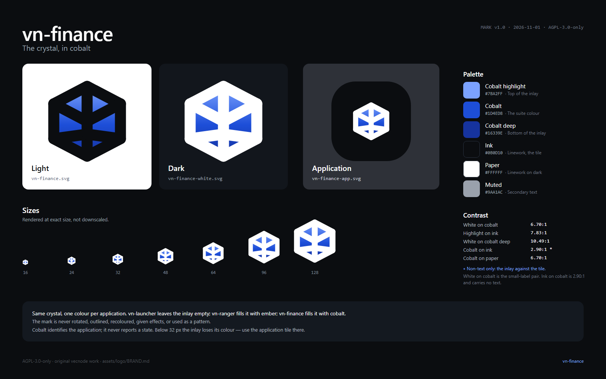

# The vn-finance mark

A girdled crystal, shared with every application in the vecnode/vn suite. The lines
are vn-launcher's; the colour inside is finance's.

The suite keeps one mark and changes one thing per application: the **inlay**, the
colour that fills the facets. vn-launcher leaves it empty, vn-ranger fills it with
ember, vn-finance fills it with cobalt. A new application gets the same crystal and a
new inlay; it does not get a new shape, a rotation, an outline variant or a different
gradient direction.

This file is the design record. [`MANIFEST.toml`](MANIFEST.toml) is the machine-readable
one: every palette value, every proportion, and the SHA-256 of every file in this
directory. [`README.md`](README.md) is the short guide.

## Construction

The mark lives on the same 24-unit grid as vn-launcher, so the two cannot drift apart:

- hexagon vertices: `(12,2.8) (20.8,7.4) (20.8,16.6) (12,21.2) (3.2,16.6) (3.2,7.4)`;
- crown ridge: `(3.2,7.4) → (12,12) → (20.8,7.4)`;
- spine: `(12,2.8) → (12,21.2)`;
- girdle: `(12,15.4) → (3.2,16.6)` and `(12,15.4) → (20.8,16.6)`;
- stroke: `2.914` units, round caps, round joins;
- facets: six, separated by the crown ridge, the girdle and the spine.

Every endpoint sits on a hexagon vertex or on the spine. That is what keeps the facets
meeting cleanly instead of crossing. The inlay is one hexagon fill beneath the linework,
so the ridges stay crisp and the facets read as one crystal rather than six coloured
tiles.

The inlay is a vertical gradient: `#7BA2FF` at the crown, `#1D4ED8` at 55%, `#16339E` at
the base. The crown catches the light; the base sits deeper.

## The cobalt

Cobalt is the window's own accent, not a colour invented for a picture. The middle stop
of the inlay **is** `theme::accent` in `crates/ui/src/theme.rs` (`#1D4ED8`), and the
highlight is that file's dark-mode accent (`#7BA2FF`). The mark and the interface are
therefore the same colour by construction: changing one and not the other is a diff
somebody sees.

| Token | Value | Use |
|---|---|---|
| Cobalt highlight | `#7BA2FF` | Top of the inlay gradient; links on dark |
| Cobalt | `#1D4ED8` | The window's accent; the suite colour for this application |
| Cobalt deep | `#16339E` | Bottom of the inlay gradient |
| Ink | `#0B0D10` | Linework on light; the application tile |
| Paper | `#FFFFFF` | Linework on dark |
| Muted | `#9AA1AC` | Secondary text on ink, never the mark |

Blue was chosen because it is what the application already is: the panel this window was
ported from was blue, `docs/UI.md` defines one accent and everything interactive in the
window uses it, and blue reads as a ledger without reading as alarm. The suite's rule is
one colour per application, and finance's colour was decided by the interface before
there was a mark to hold it.

## Contrast

Measured with the WCAG relative-luminance formula, on the pairs this asset set actually
uses:

| Pair | Ratio | Verdict |
|---|---:|---|
| White `#FFFFFF` on cobalt `#1D4ED8` | 6.70:1 | AA for normal text |
| Cobalt on paper | 6.70:1 | AA for normal text |
| Cobalt highlight `#7BA2FF` on ink | 7.83:1 | AA for normal text |
| White on cobalt deep `#16339E` | 10.49:1 | AA for normal text |
| Cobalt on ink `#0B0D10` | 2.90:1 | Non-text only: the inlay against the tile |
| Ink on cobalt | 2.90:1 | Non-text only |
| Cobalt highlight on cobalt | 2.70:1 | Never: two stops of one gradient, not a pair |

**White on cobalt is the default for small labels.** That is the one place this mark
behaves the other way round from ranger's: ink on ember is 6.36:1 and white on ember is
only 3.06:1, so ranger puts ink on its colour; cobalt is deep enough that white clears
AA and ink does not. A cobalt button or badge takes white text at any size, and never
ink text at 13 px.

Colour is identity, not status. The mark stays cobalt whether the quarter is settled or
late. Findings have their own semantic colours (`ok`, `warn`, `danger` in
`theme.rs`) and never recolour the mark.

## Clear space

Keep a margin of **6 units** on every side, one quarter of the mark's 24-unit height. At
1024 px that is 256 px; at 24 px it is 6 px. Nothing enters that margin: no text, no
badge, no border, no other mark.

The application tile's own ink square is the exception: the tile may touch the margin of
the surface it sits on, but the crystal inside it still keeps its clear space within the
tile.

In the window the mark is one square in the header, `theme::MARK` (26 points) from
`crates/ui/src/brand.rs`, followed by 9 points and the two lines of the title block. The
9 points are the clear space at that size, not a coincidence.

## Minimum sizes

| Asset | Digital | Print |
|---|---:|---:|
| Bare mark (`vn-finance.svg`, `vn-finance-white.svg`) | 32 px | 12 mm |
| Application tile (`vn-finance-app-*`) | 16 px | 6 mm |

Ranger's bare mark is allowed down to 24 px. This one is not, and the reason is the
colour rather than the geometry: a dark inlay under dark linework loses its hue sooner
than an orange one does, so at 24 px the crystal reads as a dark hexagonal blob with a
hint of blue in it. At 32 px the facets still say *blue*. The tile has no such problem —
the ink square gives the eye a solid silhouette at any size — which is why it is allowed
down to 16 px.

## Which file to use

| Family | For |
|---|---|
| `vn-finance.svg`, `vn-finance-<size>.png` | Light backgrounds. Ink linework, cobalt inlay, transparent elsewhere. |
| `vn-finance-white.svg`, `vn-finance-white-<size>.png` | Dark backgrounds. White linework, cobalt inlay, transparent elsewhere. |
| `vn-finance-app.svg`, `vn-finance-app-<size>.png` | An application icon: the mark on the suite's ink tile, with white ridges. |
| `vn-finance-app.rgba` | 64×64 unmultiplied RGBA of the tile, for packaging, a store listing or a shortcut. |
| `vn-finance-white.rgba` | 64×64 unmultiplied RGBA of the bare white mark, for the tray icon. |

If a target takes raw bytes rather than a file, it gets one of the two `.rgba` files and
not a PNG decoder: both are 16,384 bytes, exactly the three fields `egui::IconData` takes.

Sizes are 16, 24, 32, 48, 64, 128, 256, 512 and 1024 pixels square. Every PNG was
rendered at its exact size from the SVG, not downscaled from a master. Prefer the SVG
wherever the target accepts it.

## The application icon

- Tile: 1024 × 1024, corner radius **308** (30.1%), fill `#0B0D10`.
- Crystal: the same 24-unit geometry, scaled **22.73×** and translated **239.25 px**,
  so the visible mark is about 468 × 486 px and sits at the optical centre.
- Ridges: white; inlay: cobalt.
- The raw icon is 64 × 64 unmultiplied RGBA, 16,384 bytes.

The tile is ink, not cobalt. An icon has to hold its own against whatever is behind it:
a bare cobalt glyph sinks into a dark taskbar and a bare white one disappears on a light
one, whereas an ink tile with a white crystal and a cobalt inlay reads on both.

**Where vn-finance itself uses which.** The application tile is the window icon
(`apps/vnfin/src/main.rs`) and the mark in the header (`crates/ui/src/brand.rs`), from one
constant — `brand::TILE` — so the title bar and the window cannot disagree, and the
interface does not swap artwork when the theme changes. Nothing in this application uses
the bare mark: there is no tray icon yet, and a bare cobalt crystal at the window's only
mark position would read as a bullet rather than as a logo.

## Using it

**Do**

- put the light mark on paper and the white mark on ink;
- use the application tile for a taskbar, a window, a store listing or a favicon;
- keep the clear space and the proportions;
- pair the mark with the name in text when the mark is small;
- use white on cobalt for small labels and buttons.

**Do not**

- rotate, skew, stretch, crop, outline, bevel or add a shadow to the mark;
- recolour the inlay, or change its gradient direction;
- use the mark as a repeating pattern, a texture or a loading spinner;
- put the bare mark on a busy photograph or a low-contrast background;
- set ink text on cobalt below 24 px;
- use the mark to imply an audit, a filing or an approval it did not perform;
- redraw the facets. The geometry is the suite identifier; a new application changes the
  inlay, not the crystal.

## Type

The wordmark is not part of this asset set yet. If one is added, use **Inter** (SIL Open
Font License 1.1), set the name in title case, and keep the same clear space around the
lockup. Do not draw a custom wordmark in the crystal's style: the crystal is the mark,
and the name is the name.

The window's header is the exception that proves it: it sets `vn-finance` in the
interface's own type at `theme::PAGE_TITLE`, because there it is a title, not a logo.

## Accessibility

- The mark is decorative when the name is beside it; give the image an empty `alt` in
  that case. When it stands alone, `alt="vn-finance"`.
- Colour is never the only signal. The inlay identifies the application; it does not
  report a state.
- The contrast pairs in the table above are the only ones approved for text.
- At small sizes, use the tile rather than a thin-stroked bare mark.

## Regenerating

The SVGs are the source of truth. To regenerate:

1. Render each SVG at the exact pixel size (a headless browser, `resvg`, or any SVG
   rasteriser) onto a transparent canvas.
2. For the application tile, keep the ink rounded square; only the corners are
   transparent.
3. Decode `vn-finance-app-64.png` to unmultiplied RGBA and write the 16,384 raw bytes to
   `vn-finance-app.rgba`; decode `vn-finance-white-64.png` the same way to
   `vn-finance-white.rgba`.
4. Regenerate `contact-sheet.png` from the rendered set.
5. Regenerate `MANIFEST.toml` so every digest matches the files that shipped.

A future `cargo xtask logo` will own steps 1–5, so the set is reproducible rather than
hand-maintained. Until then, the geometry above and the SVGs are enough to regenerate it
exactly.

## Licence

AGPL-3.0-only, like the rest of the repository — see [`../../LICENSE`](../../LICENSE).
The mark is original vecnode work and contains no third-party asset.
