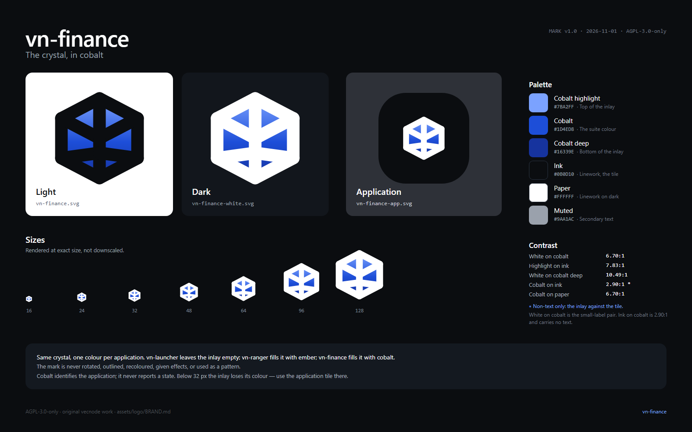

# The vn-finance mark

A girdled crystal, shared with every application in the vecnode/vn suite. The lines are
vn-launcher's; the colour inside is finance's.

The suite keeps one mark and changes one thing per application: the **inlay**, the colour
that fills the facets. vn-launcher leaves it empty, vn-ranger fills it with ember,
vn-finance fills it with cobalt.

This file is the quick guide. [`BRAND.md`](BRAND.md) is the design record —
construction, clear space, minimum sizes, contrast and usage rules. [`MANIFEST.toml`](MANIFEST.toml)
is the machine-readable one: every palette value and the SHA-256 of every file here.

## Geometry

The mark lives on the same 24-unit grid as vn-launcher, so the two cannot drift apart:

- a hexagon with vertices at `(12,2.8) (20.8,7.4) (20.8,16.6) (12,21.2) (3.2,16.6) (3.2,7.4)`;
- a crown ridge `(3.2,7.4) → (12,12) → (20.8,7.4)`;
- a spine `(12,2.8) → (12,21.2)`;
- a girdle `(12,15.4) → (3.2,16.6)` and `(12,15.4) → (20.8,16.6)`;
- a stroke of `2.914` units, round caps and round joins.

Every endpoint sits on a hexagon vertex or on the spine, which is what keeps the facets
meeting cleanly instead of crossing. The inlay is a single hexagon fill under the
linework, so the ridges stay crisp and the facets read as one crystal rather than six
coloured tiles.

## The cobalt

| Token | Value | Use |
|---|---|---|
| Cobalt highlight | `#7BA2FF` | Top of the inlay gradient |
| Cobalt | `#1D4ED8` | The window's accent; the suite colour for this application |
| Cobalt deep | `#16339E` | Bottom of the inlay gradient |
| Ink | `#0B0D10` | Linework on light backgrounds; the application tile |
| Paper | `#FFFFFF` | Linework on dark backgrounds |
| Muted | `#9AA1AC` | Secondary text on ink, never the mark |

The gradient is vertical, `#7BA2FF → #1D4ED8` at 55% `→ #16339E`, so the crown catches
the light and the base sits deeper.

Cobalt is not a colour invented for a picture: the middle stop is the accent the window
already draws with (`theme::accent` in `crates/ui/src/theme.rs`), and the highlight is
that file's dark-mode accent. The mark and the interface are the same blue by
construction, so they cannot drift apart.

White on cobalt is 6.70:1 and is the pair used for small text — the opposite of ranger,
where the colour is bright enough that ink has to carry the label. Cobalt on ink is
2.90:1 and is never text. [`BRAND.md`](BRAND.md) has the full table.

## Which file to use

| Family | For |
|---|---|
| `vn-finance.svg`, `vn-finance-<size>.png` | Light backgrounds. Ink linework, cobalt inlay, transparent elsewhere. |
| `vn-finance-white.svg`, `vn-finance-white-<size>.png` | Dark backgrounds. White linework, cobalt inlay, transparent elsewhere. |
| `vn-finance-app.svg`, `vn-finance-app-<size>.png` | An application icon: the mark on the suite's ink tile, with white ridges. |
| `vn-finance-app.rgba` | 64×64 unmultiplied RGBA for `egui::IconData`, embedded with `include_bytes!`. |

## Sizes

16, 24, 32, 48, 64, 128, 256, 512 and 1024 pixels square.

**Prefer the SVG** wherever the target accepts it. It scales without resampling and is
the only file here that belongs in a print job or a store listing. The PNGs exist
because most places still want one.

Each PNG was rendered at its exact size from the SVG, not downscaled from a master.
That matters most at the bottom of the range, where resampling a 1024 down to 16 turns
a 2.9-unit stroke into a grey smear.

## Below about 32 pixels

The faceting costs legibility as the size drops, and cobalt costs one step more than
ember does: a dark inlay under dark linework loses its hue before a bright one does. At
24 pixels the bare mark is a dark hexagonal blob with a hint of blue in it, which is
about as much as any six-line mark can say at that size.

Where a small icon has to be recognisable, use `vn-finance-app-16.png`: the ink tile
gives the eye a solid silhouette to hold on to, and the cobalt gives it a colour to find.
The bare mark is specified from **32 px** up; the tile from 16 px.

## The application icon

`vn-finance-app.rgba` is 64×64 unmultiplied RGBA, exactly the three fields
`egui::IconData` takes. `crates/ui/src/brand.rs` embeds it as `brand::TILE`, the window
icon in `apps/vnfin/src/main.rs` is built from the same constant, and the header paints
the same texture — so the title bar and the window cannot disagree, and putting an icon
on both costs the application no image decoder.

The application tile is 1024 × 1024 with a **308 px** corner radius; the crystal is
scaled **22.73×** and translated **239.25 px** so its visible bounds are about
468 × 486 px, centred. The tile is the suite's ink, not the cobalt. An icon has to hold
its own against whatever is behind it: a bare cobalt glyph sinks into a dark taskbar and
a bare white one disappears on a light taskbar, whereas an ink tile with a white crystal
and a cobalt inlay reads on both.

## The suite rule

**Same crystal, one colour per application, no other variants.** The mark is a suite
identifier, not a per-project illustration. A new vecnode/vn application gets the same
geometry and a new inlay colour; it does not get a new shape, a rotation, an outline
variant or a gradient in a different direction.

| Application | Inlay |
|---|---|
| vn-launcher | none |
| vn-ranger | ember `#F26A21` |
| vn-finance | cobalt `#1D4ED8` |

## Regenerating

The SVGs are the source of truth. The PNGs and the `.rgba` are generated:

1. Render each SVG at the exact pixel size (a browser in headless mode, `resvg`, or
   any SVG rasteriser) onto a transparent canvas.
2. For the application tile, keep the ink rounded square; only the corners are
   transparent.
3. Decode `vn-finance-app-64.png` to unmultiplied RGBA and write the 16,384 raw bytes to
   `vn-finance-app.rgba`; decode `vn-finance-white-64.png` the same way to
   `vn-finance-white.rgba`.
4. Regenerate `contact-sheet.png` and `MANIFEST.toml`, and keep `crates/ui/src/brand.rs`
   in step with the tiles; this directory is the distribution copy, not the drawing code.

A future `cargo xtask logo` will do this, so the set is reproducible rather than
hand-maintained. Until then, the geometry in [`BRAND.md`](BRAND.md) and the SVGs are
enough to regenerate it exactly.

## Licence

AGPL-3.0-only, like the rest of the repository — see [`../../LICENSE`](../../LICENSE).
The mark is original vecnode work and contains no third-party asset.
